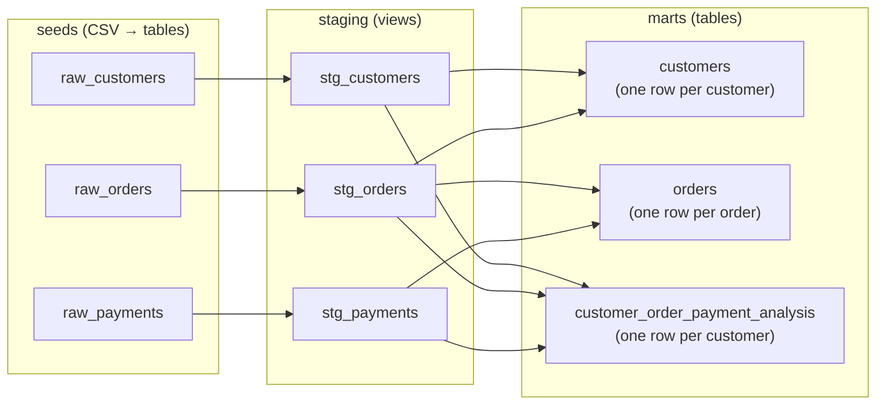

# jaffle_shop (DuckDB) — User Guide

A practical guide to understanding, running, and extending this repository. For the quick-start-only version, see [README.md](README.md).

---

## 1. What this project is

`jaffle_shop` is a fictional ecommerce store. This repo is a **self-contained dbt playground project** that transforms raw CSV data into analytics-ready `customers` and `orders` tables — entirely on your local machine, using [DuckDB](https://duckdb.org/) as the database. No warehouse account, no cloud, no cost, and the whole build finishes in under a second.

What this repo **is**:

- A playground dbt project for testing out scripts and communicating core dbt concepts
- One of the fastest ways to see dbt work end to end: seed → stage → model → test → docs

What this repo **is not**:

- A tutorial — see the [dbt Getting Started Tutorial](https://docs.getdbt.com/tutorial/setting-up) for that
- A best-practices reference — see [dbt Learn Demo](https://github.com/dbt-labs/dbt-learn-demo) instead. This project deliberately uses **seeds instead of sources**, relaxed file-naming conventions, and has no PR flow or CI/CD for the project itself
- A demo of advanced dbt features (macros, packages, hooks, operations) — it intentionally stays simple

---

## 2. Repository layout

| Path | Purpose |
|---|---|
| `dbt_project.yml` | Project definition: name, paths, materialization defaults, required dbt version (`>=1.11.0, <2.0.0`) |
| `profiles.yml` | dbt connection profile — targets DuckDB at `jaffle_shop.duckdb`, target `dev`, 24 threads |
| `pyproject.toml` / `uv.lock` / `requirements.txt` | Python dependency specs for uv and pip |
| `.python-version` | Pins Python 3.13 for pyenv/uv |
| `seeds/` | Raw CSV data: `raw_customers.csv`, `raw_orders.csv`, `raw_payments.csv` |
| `models/staging/` | Staging views (`stg_customers`, `stg_orders`, `stg_payments`) + their schema/tests |
| `models/` | Mart models `customers.sql`, `orders.sql`, `customer_order_payment_analysis.sql` + `schema.yml` (docs and tests) |
| `models/docs.md` / `models/overview.md` | dbt docs blocks (e.g. the `orders_status` reference table) |
| `etc/dbdiagram_definition.txt` | [DBDiagram.io](https://dbdiagram.io) definition of the raw entity model |
| `.sqlfluff` | SQL linter config (dialect: `duckdb`) |
| `Dockerfile` / `.devcontainer.json` | Dev container for VS Code / GitHub Codespaces |
| `.github/workflows/validate_on_platforms.yml` | CI validating the getting-started flow on 5 platform/shell combinations |
| `dbt-completion.bash` | Bash autocompletion for the dbt CLI |
| `RELEASE.md` | Maintainer instructions for updating dependencies |

---

## 3. Data architecture

### 3.1 Flow (the DAG)



Materialization is configured in `dbt_project.yml`:

| Layer | Materialization | Docs node color |
|---|---|---|
| Seeds | table (dbt seed default) | `#cd7f32` (bronze) |
| `staging` | view | silver |
| Marts (`models/` root) | table | gold |

Everything lands in the default `main` schema of the single local file `jaffle_shop.duckdb`.

### 3.2 Entity relationships (raw)

```
customers (id PK) ◄── orders (user_id → customers.id) ◄── payments (order_id → orders.id)
```

Source definition lives in `etc/dbdiagram_definition.txt`.

### 3.3 What each model does

| Model | Type | Grain | What it does |
|---|---|---|---|
| `stg_customers` | view | one row per customer | Renames `id` → `customer_id` |
| `stg_orders` | view | one row per order | Renames `id` → `order_id`, `user_id` → `customer_id` |
| `stg_payments` | view | one row per payment | Renames `id` → `payment_id`; converts `amount` from **cents to dollars** (`amount / 100`) |
| `customers` | table | one row per customer | First-order and most-recent-order dates, order count, lifetime value (`customer_lifetime_value`) |
| `orders` | table | one row per order | Payment amounts pivoted per method (`credit_card_amount`, `coupon_amount`, `bank_transfer_amount`, `gift_card_amount`) plus total (`amount`) |
| `customer_order_payment_analysis` | table | one row per customer | Complex analytical mart joining all three entities. Payment-method mix per customer, cohort month, customer tenure, average order value, and window-function metrics (running totals, per-customer order rank, inter-order gaps) |

The payment-method pivot in `models/orders.sql` is driven by a Jinja list:

```jinja

```

Adding a new method to that list automatically generates the corresponding columns.

### 3.4 Known quirk

`models/schema.yml` documents a `total_order_amount` column on `customers`, but the model actually outputs `customer_lifetime_value`. Harmless, but don't be surprised when browsing the docs.

### 3.5 The analytical mart (`customer_order_payment_analysis`)

`models/customer_order_payment_analysis.sql` is a complex analytical model that joins all three entities (`customers` → `orders` → `payments`) and demonstrates advanced SQL techniques:

| Technique | Where | What it computes |
|---|---|---|
| **Conditional aggregation / pivoting** | `order_payments` | Each payment method (`credit_card`, `coupon`, `bank_transfer`, `gift_card`) is pivoted into its own column per order using `CASE WHEN` |
| **Window functions** | `enriched_orders` | A running total per customer (`SUM(...) OVER (PARTITION BY customer_id ORDER BY order_date ...)`), a per-customer order rank by amount (`RANK()`), and the previous order date (`LAG()`) |
| **Cohort analysis** | `customer_metrics` | The customer's acquisition month (`strftime(min(order_date), '%Y-%m')`) |
| **Tenure & AOV** | `customer_metrics` | Days between first and most recent order (`datediff`), plus average order value |
| **Lifetime value** | `customer_metrics` | Running total captured at the most recent order (`max(customer_running_total)`) |
| **Payment-method mix** | `customer_payment_mix` | Total paid per method per customer, computed by re-joining `payments` to `orders` |
| **Order tiering** | `enriched_orders_final` | Flags orders as `high_value` when they exceed 2× the customer's average order value |

The final output is one row per customer, ordered by `customer_lifetime_value` descending, then `most_recent_order_date` descending.

---

## 4. Prerequisites

- **Python ≥ 3.13** (`.python-version` pins 3.13 for pyenv/uv; `pyproject.toml` requires `>=3.13`)
- Dependencies declared in `pyproject.toml`:
  - `dbt-core >= 1.12.0`
  - `dbt-duckdb >= 1.10.1`
  - `sqlfluff >= 3` (SQL linting)
- Optional: [uv](https://docs.astral.sh/uv/getting-started/installation/) (recommended), the [DuckDB CLI](https://duckdb.org/docs/installation/?environment=cli) for querying, Docker Desktop for the dev container

---

## 5. Getting started

### Option A — uv (recommended, fastest)

```shell
git clone https://github.com/dbt-labs/jaffle_shop_duckdb.git
cd jaffle_shop_duckdb
uv sync                       # creates .venv with pinned deps from uv.lock
```

Then either activate the venv…

```powershell
.venv\Scripts\Activate.ps1     # Windows PowerShell
# source .venv/bin/activate    # macOS / Linux
```

…or run dbt through uv without activating:

```shell
uv run dbt build
```

### Option B — pip + venv

Windows PowerShell:

```powershell
python -m venv venv
venv\Scripts\Activate.ps1
python -m pip install --upgrade pip
python -m pip install -r requirements.txt
```

macOS / Linux (bash/zsh):

```shell
python3 -m venv venv
source venv/bin/activate
python3 -m pip install --upgrade pip
python3 -m pip install -r requirements.txt
```

> If `dbt --version` shows an unexpected version after install, reactivate the virtual environment — a stale `dbt` shim elsewhere on PATH can shadow the venv's.

### Option C — GitHub Codespaces / Dev Container

1. On the repo page, click green **Code** → **Codespaces** tab → "Create codespace on `duckdb`"
2. When the codespace opens, a Task pane runs `dbt build` automatically
3. Local Docker alternative: install Docker Desktop + the VS Code **Dev Containers** extension, then *Remote-Containers: Open Folder in Container* (first build takes a few minutes)

The dev container configures: dbt/Jinja SQL syntax highlighting (vscode-dbt), sqlfluff lint-as-you-type, macro snippet autocompletion, dbt YAML JSON schemas, find-related navigation between model/compiled/run files, and a 99-char ruler.

> **Local environment note (this machine):** Python 3.14.6 is installed and satisfies the ≥ 3.13 requirement, but `uv`, `dbt`, and the DuckDB CLI are not on PATH yet and no `.venv` exists — run Option A or B before the commands below.

### Verify the setup

```shell
dbt --version
dbt debug
```

`dbt debug` should report all connection checks passed. It reads `profiles.yml` from the repo root, which requires nothing but the local `jaffle_shop.duckdb` file.

---

## 6. Running the project

### One shot

```shell
dbt build
```

`dbt build` runs seeds, models, and tests in dependency order — this is all you need.

### Step by step

```shell
dbt seed   # load the CSVs into tables (a normal project reads raw data from a warehouse instead)
dbt run    # build staging views + mart tables
dbt test   # run the data tests
dbt clean  # remove target/, logs/ and dbt_modules/ build artifacts
```

> If you point the project at a different warehouse and models fail, small SQL dialect adjustments in `models/` may be needed.

---

## 7. What a build produces

| Artifact | Description |
|---|---|
| `jaffle_shop.duckdb` | The DuckDB database file (created at repo root) |
| Tables in `main` | `raw_customers`, `raw_orders`, `raw_payments`, `customers`, `orders`, `customer_order_payment_analysis` |
| Views in `main` | `stg_customers`, `stg_orders`, `stg_payments` |
| `target/` | Compiled SQL, run results, docs catalog |
| `logs/` | dbt logs |

---

## 8. Querying the data

DuckDB CLI (one-liner or interactive):

```shell
duckdb jaffle_shop.duckdb -c "select * from customers where customer_id = 42"

duckdb jaffle_shop.duckdb
```

Python (works without the CLI installed, since duckdb ships with dbt-duckdb):

```python
import duckdb
conn = duckdb.connect('jaffle_shop.duckdb')
print(conn.sql('select * from customers where customer_id = 42').fetchall())
conn.close()
```

GUI options: the [DuckDB UI](https://duckdb.org/docs/stable/extensions/ui.html) and [DBeaver](https://duckdb.org/docs/guides/sql_editors/dbeaver).

---

## 9. Data tests

Defined in `models/schema.yml` and `models/staging/schema.yml`:

| Test | Applied to |
|---|---|
| `unique` + `not_null` | `stg_customers.customer_id`, `stg_orders.order_id`, `stg_payments.payment_id` |
| `not_null` + `relationships` → `customers` | `orders.customer_id` |
| `not_null` | `customers.customer_id`, `orders.order_id`, `orders.amount`, and the four per-method amount columns |
| `accepted_values` | `orders.status` (`placed`, `shipped`, `completed`, `return_pending`, `returned`) and `stg_payments.payment_method` (`credit_card`, `coupon`, `bank_transfer`, `gift_card`) |
| `unique` + `not_null` | `customer_order_payment_analysis.customer_id` |

Run subsets with node selection:

```shell
dbt test --select stg_payments     # only tests on that model
dbt build --select customers+      # customers and everything downstream
```

---

## 10. Project documentation site

```shell
dbt docs generate
dbt docs serve     # opens http://localhost:8080
```

The site includes the DAG (color-coded bronze/silver/gold by layer), column descriptions, and the `orders_status` reference table rendered from the doc block in `models/docs.md`.

---

## 11. SQL linting

sqlfluff is configured with the `duckdb` dialect (`.sqlfluff`):

```shell
sqlfluff lint models/
sqlfluff fix models/
```

---

## 12. CI (maintainers)

`.github/workflows/validate_on_platforms.yml` runs on every push/PR to the `duckdb` branch and validates the full getting-started flow — `uv sync` → `dbt debug` → `dbt build` → `dbt docs generate` → query `customer_id = 42` via Python — on: macOS (bash), Linux (bash), Linux (PowerShell Core), Windows (PowerShell), and Windows (cmd.exe).

---

## 13. Updating dependencies (maintainers)

Per [RELEASE.md](RELEASE.md):

```shell
uv lock                                            # update uv.lock
uv pip compile pyproject.toml -o requirements.txt  # regenerate pip requirements
```

Commit both files and open a PR.

---

## 14. Troubleshooting

**`IO Error: Could not set lock on file "jaffle_shop.duckdb"`**
Another session holds the database — DuckDB allows only one read/write process at a time. Close any CLI prompts, the DuckDB UI, or DBeaver (with DBeaver, fully shutting the app down works; merely disconnecting may not). Worst case, delete `jaffle_shop.duckdb` — you lose the data, but `dbt build` recreates everything.

**`dbt` not found or wrong version after install**
Reactivate your virtual environment; a globally installed dbt may be shadowing the venv's.

**Codespaces docs-preview warnings**
Privacy-focused browsers (Firefox, Brave) or cookie-blocking extensions may show an error in the codespace preview. Ignore it or use Chrome — it doesn't affect the demo.

**Port already in use for docs**
`dbt docs serve --port 8081`.

---

## 15. Learning more

- [Introduction to dbt](https://docs.getdbt.com/docs/introduction)
- [The dbt viewpoint](https://docs.getdbt.com/docs/about/viewpoint)
- [dbt Community](http://community.getdbt.com/)
